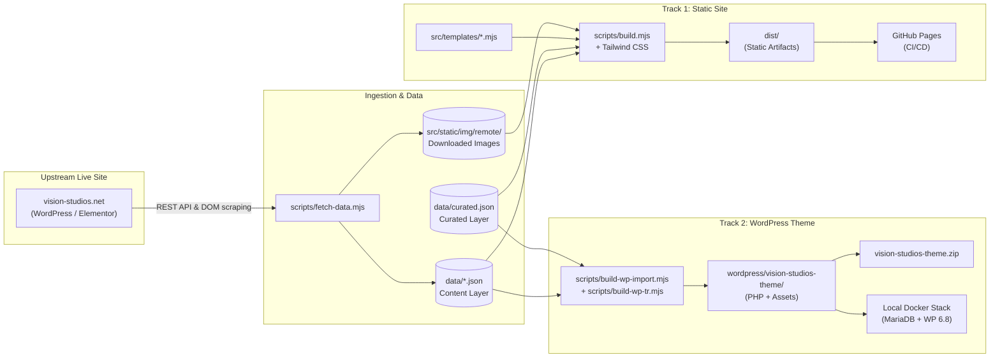

# Vision Studios — Website & Theme Engine

[](package.json)
[](tailwind.config.js)
[](wordpress/docker-compose.yml)
[](wordpress/docker-compose.yml)
[](.github/workflows/deploy.yml)

A high-performance static marketing website and production WordPress theme powering [Vision Studios](https://vision-studios.net) — a premier television, broadcast, and virtual production studio hire network operating in **London**, **Dublin**, **Paris**, and **Istanbul**.

---

## Table of Contents
1. [Project Overview](#1-project-overview)
2. [Key Features](#2-key-features)
3. [Technology Stack](#3-technology-stack)
4. [System Architecture](#4-system-architecture)
5. [System Requirements](#5-system-requirements)
6. [Installation Guide](#6-installation-guide)
7. [Configuration Reference](#7-configuration-reference)
8. [Usage Guide](#8-usage-guide)
9. [Production Deployment](#9-production-deployment)
10. [Updating & Maintenance](#10-updating--maintenance)
11. [Troubleshooting](#11-troubleshooting)
12. [Project Structure](#12-project-structure)
13. [Development & Contribution](#13-development--contribution)
14. [Licence & Ownership](#14-licence--ownership)
15. [Project Status](#15-project-status)
16. [Support & Contact](#16-support--contact)
- [Repository Metadata](#repository-metadata)
- [Documentation Index](#documentation-index)

---

## 1. Project Overview

The repository provides a unified solution for Vision Studios through a dual-track implementation:

- **Track 1 (Static Site Generator)**: A zero-npm-dependency Node.js static generator that converts structured JSON content into lightning-fast, pre-rendered static HTML, minified Tailwind CSS, and responsive WebP image variants in `dist/`.
- **Track 2 (WordPress Theme)**: A bespoke, native classic WordPress theme (`wordpress/vision-studios-theme/`) designed for WordPress 6.8+ and PHP 8.3, including custom post types, custom taxonomies, built-in meta boxes, an automated content importer, and native Turkish multilingual support.

All content originates from the live public WordPress and Elementor implementation at `https://vision-studios.net`, normalized via automated ingestion scripts, and styled with a dark editorial design system (Anton, Inter, Space Mono typography; dark charcoal canvas with `#f2703a` orange accents).

---

## 2. Key Features

- **Dual-Track Delivery**: Deploy as an immutable, lightning-fast static site on GitHub Pages/Netlify or as a full-featured theme on a live WordPress installation.
- **Automated Content Ingestion**: `scripts/fetch-data.mjs` extracts pages, news posts, media assets, Elementor widgets, and gallery backgrounds from `vision-studios.net` into structured JSON records.
- **Zero NPM Dependencies**: The static generator uses native Node.js standard libraries (`node:fs/promises`, `node:child_process`, `node:http`). CLI tools (`tailwindcss`, `esbuild`) execute via `npx -y` on demand.
- **Multi-City Studio Catalog**: Complete studio pages for 14 facilities across London, Dublin, Paris, and Istanbul with technical specs, floor plans, photo galleries, and use-case guides.
- **Native Multilingual Subsystem (`/tr/`)**: Integrated Turkish localization for Istanbul studios and city landing pages without external translation plugins.
- **Responsive Image Optimization**: Auto-detects `cwebp` to emit multi-density variants (`640w`, `1024w`, `1600w`) with automated dimension extraction directly from file byte headers.
- **Click-to-Load Performance Facades**: Heavy third-party assets (such as Google Maps iframes) use interactive facades, eliminating ~1 MB of blocking scripts on initial load.
- **Comprehensive On-Page SEO**: Built-in JSON-LD schemas (`LocalBusiness`, `Organization`, `WebSite`, `BreadcrumbList`, `NewsArticle`), canonical tags, Open Graph meta, XML sitemaps, robots.txt, and automated CLI auditing via `npm run seo:audit`.
- **Turnkey Local WordPress Environment**: Pre-configured `wordpress/docker-compose.yml` orchestrating MariaDB 11, WordPress 6.8, and WP-CLI for local theme iteration and testing.

---

## 3. Technology Stack

| Layer | Technologies & Tools |
|---|---|
| **Static Site Generator** | Node.js (ES modules, `node:fs/promises`, `node:child_process`, `node:http`), Zero npm runtime dependencies |
| **Styling & Design System** | Tailwind CSS `3.4.17`, Self-hosted WOFF2 fonts (`Anton`, `Inter-var`, `Space Mono`), Inline SVG icons |
| **Client-Side Interactivity** | Pure Vanilla JavaScript (`src/static/app.js`, ~13 KB), `IntersectionObserver` animations, Lightbox modal |
| **Asset Optimization** | `cwebp` CLI (from the `webp` package) for responsive WebP generation (`-q 78`) |
| **CMS & Theme Engine** | WordPress `6.8`, PHP `8.3`, Custom Post Types, Custom Taxonomies, Custom Meta Boxes, Customizer API |
| **Theme Build Tools** | `esbuild@0.28.2` (JavaScript and CSS minification), `tailwindcss@3.4.17` |
| **Local Infrastructure** | Docker & Docker Compose v2, MariaDB `11`, WordPress 6.8 Apache, WP-CLI `2.11` |
| **CI/CD & Hosting** | GitHub Actions (`.github/workflows/deploy.yml`), GitHub Pages |

---

## 4. System Architecture



For in-depth architectural specifications and data flow sequences, see [`docs/ARCHITECTURE.md`](docs/ARCHITECTURE.md).

---

## 5. System Requirements

### Hardware Requirements
- **Static Site Build**: Minimum 1 CPU core, 512 MB RAM, ~200 MB disk space (includes ~25 MB downloaded images).
- **Local WordPress (Docker)**: Minimum 2 CPU cores, 2 GB RAM (WordPress container configured with 1024M memory limit for imports), 2 GB free disk space.

### Software Runtimes & Dependencies
- **Node.js**: `>= 18.0.0` (LTS v20 or v22 recommended).
- **npm**: Bundled with Node.js.
- **Docker & Docker Compose**: Docker Engine `>= 20.10` / Compose v2 (required only for Track 2 local WordPress).
- **cwebp**: Optional utility for responsive image generation (Ubuntu: `apt install webp`, macOS: `brew install webp`).

---

## 6. Installation Guide

### Quick Start (Static Site)
```bash
# 1. Clone the repository
git clone https://github.com/medhatse/Vision-Studio.git
cd Vision-Studio

# 2. Build the static site into dist/
npm run build

# 3. Start local preview server (http://localhost:4173)
npm run serve
```

> **Note**: No `npm install` is necessary. The repository has zero npm dependencies.

### Quick Start (Local WordPress via Docker)
```bash
# 1. Start Docker containers (MariaDB + WordPress + WP-CLI)
npm run wp:up

# 2. Run initial WordPress setup
cd wordpress
docker compose run --rm cli core install \
  --url=http://localhost:8080 \
  --title="Vision Studios" \
  --admin_user=admin \
  --admin_password=admin \
  --admin_email=admin@example.com \
  --skip-email
docker compose run --rm cli rewrite structure '/%postname%/'
docker compose run --rm cli theme activate vision-studios
cd ..

# 3. Import studio content and media
npm run wp:import
```

Open [http://localhost:8080](http://localhost:8080) (Admin: `admin` / `admin`).

For detailed installation instructions, see [`docs/INSTALLATION.md`](docs/INSTALLATION.md).

---

## 7. Configuration Reference

### Environment Variables

| Variable | Default | Purpose |
|---|---|---|
| `SITE_URL` | `http://localhost:4173` | Canonical base URL for sitemap, robots, and Open Graph meta. |
| `BASE_PATH` | `""` | Base path prefix for subfolder hosting (e.g. `/Vision-Studio`). |
| `CNAME_DOMAIN` | *None* | Generates `dist/CNAME` for custom domain GitHub Pages hosting. |
| `PORT` | `4173` | TCP port for local static preview server. |

### Configuration Examples
```bash
# Build for production domain
SITE_URL=https://vision-studios.net npm run build

# Build for GitHub Pages subfolder
SITE_URL=https://medhatse.github.io BASE_PATH=/Vision-Studio npm run build

# Serve on custom port
PORT=8000 npm run serve
```

For complete data schemas, Tailwind styling variables, and WordPress Customizer settings, see [`docs/CONFIGURATION.md`](docs/CONFIGURATION.md).

---

## 8. Usage Guide

### Available NPM Scripts

| Script | Command | Description |
|---|---|---|
| `npm run build` | `node scripts/build.mjs` | Compiles templates, CSS, redirects, and sitemaps into `dist/`. |
| `npm run dev` | `node scripts/build.mjs && node scripts/serve.mjs` | Builds the static site and launches the preview server. |
| `npm run serve` | `node scripts/serve.mjs` | Starts the zero-dependency preview server for `dist/` on port 4173. |
| `npm run fetch` | `node scripts/fetch-data.mjs` | Pulls content and downloads ~228 images from `vision-studios.net`. |
| `npm run seo:audit` | `node scripts/seo-audit.mjs` | Crawls endpoints and audits metadata, Open Graph, schema, and headers. |
| `npm run theme:css` | `cd wordpress && npx -y tailwindcss...` | Recompiles Tailwind CSS for the WordPress theme. |
| `npm run theme:minify` | `npx -y esbuild...` | Minifies JavaScript and post-production CSS for the theme. |
| `npm run theme:import-data` | `node scripts/build-wp-import.mjs...` | Compiles `data/*.json` into theme import payloads (`import.json`, `tr.json`). |
| `npm run theme:zip` | *(composite)* | Compiles assets and bundles `wordpress/vision-studios-theme.zip`. |
| `npm run wp:up` | `cd wordpress && docker compose up -d` | Starts local MariaDB and WordPress containers. |
| `npm run wp:down` | `cd wordpress && docker compose down` | Stops local WordPress containers. |
| `npm run wp:import` | `cd wordpress && docker compose run...` | Imports content into local WordPress using WP-CLI. |

---

## 9. Production Deployment

### Static Site (GitHub Pages)
The repository automatically deploys pushes to the `main` branch via `.github/workflows/deploy.yml`:
1. Checks out repository.
2. Configures Node.js 22 and installs `webp` (`cwebp`).
3. Executes `npm run build` with dynamic `SITE_URL` and `BASE_PATH`.
4. Uploads and deploys the `dist/` directory to GitHub Pages.

### WordPress Theme Live Deployment
1. Run `npm run theme:zip` to build `wordpress/vision-studios-theme.zip`.
2. In WordPress Admin: **Appearance → Themes → Add New → Upload Theme**.
3. Activate the theme and navigate to **Settings → Permalinks → Save Changes**.
4. Go to **Studios → Import Content → Run import** (leave *"Also import news posts"* unchecked on a live site with existing posts).
5. If using **Rank Math SEO**, configure title templates and XML sitemaps as detailed in [`docs/DEPLOYMENT.md`](docs/DEPLOYMENT.md).

---

## 10. Updating & Maintenance

- **Content Refresh**: Run `npm run fetch` to synchronize latest changes from `vision-studios.net`.
- **Payload Refresh**: Run `npm run theme:import-data` to update theme import payloads.
- **SEO Validation**: Run `npm run seo:audit -- http://localhost:4173 / /studios/` to verify compliance.
- **Performance Benchmarking**: The static build scores 100/100/100/100 across Lighthouse categories (Performance, Accessibility, Best Practices, SEO) on desktop presets.

For operational guidelines, see [`docs/OPERATIONS.md`](docs/OPERATIONS.md).

---

## 11. Troubleshooting

| Symptom | Cause | Resolution |
|---|---|---|
| `cwebp not found` warning | Missing `webp` system package | Install `webp` (`apt install webp` or `brew install webp`). Build continues normally with original images. |
| 404 on studio/city URLs in WP | WordPress permalinks not flushed | Go to **Settings → Permalinks** and click **Save Changes**. |
| PHP memory exhausted on WP import | Image processing exceeds limit | Docker is preconfigured with 1024M; ensure host has 2 GB+ RAM assigned to Docker. |
| Form submission opens mail client | Default fallback behavior | Configure Formspree/API in `src/static/app.js` or Contact Form 7 in WordPress Customizer. |
| Style updates missing in theme | Precompiled CSS not rebuilt | Run `npm run theme:css` to recompile `assets/app.css`. |

For complete troubleshooting workflows, see [`docs/TROUBLESHOOTING.md`](docs/TROUBLESHOOTING.md).

---

## 12. Project Structure

```text
Vision-Studio/
├── .github/workflows/deploy.yml # GitHub Actions deployment workflow
├── data/                        # Structured content (JSON) & Turkish translations
│   ├── curated.json             # Hand-maintained presentation overlay
│   ├── studios.json             # 14 studio facility profiles
│   ├── cities.json              # London, Dublin, Paris, Istanbul data
│   └── tr/                      # Turkish translations (city, studios, UI)
├── docs/                        # Complete technical documentation suite
│   ├── ARCHITECTURE.md          # In-depth system architecture & diagrams
│   ├── INSTALLATION.md          # Step-by-step setup guide
│   ├── CONFIGURATION.md         # Environment variables & data configuration
│   ├── DEPLOYMENT.md            # GitHub Pages, static hosts & live WP deployment
│   ├── OPERATIONS.md            # Content sync, SEO auditing & maintenance
│   ├── TROUBLESHOOTING.md       # Diagnostic guide and solutions
│   ├── DEVELOPMENT.md           # Developer guidelines & coding standards
│   └── SECURITY.md              # Security posture & vulnerability reporting
├── scripts/                     # Build, fetch, image, and audit scripts (Node.js)
├── src/                         # Static site templates & static assets
│   ├── static/                  # CSS, JS, fonts, and remote images
│   └── templates/               # Modular HTML rendering templates
├── wordpress/                   # WordPress theme & Docker Compose setup
│   ├── docker-compose.yml       # MariaDB 11, WordPress 6.8, WP-CLI
│   └── vision-studios-theme/    # Production WordPress theme
├── package.json                 # Scripts and engine requirements
├── README.md                    # Primary repository documentation (this file)
└── README-wordpress.md          # Detailed WordPress theme documentation
```

---

## 13. Development & Contribution

- Always preserve the **zero npm dependencies** design for the static generator.
- Modify source assets (`assets/app.src.js`, `assets/post-production.src.css`), never the compiled targets.
- Verify changes with `npm run build` and `npm run seo:audit` prior to opening a PR.

For developer conventions and contribution instructions, see [`docs/DEVELOPMENT.md`](docs/DEVELOPMENT.md).

---

## 14. Licence & Ownership

- **Proprietary & Confidential**: This repository contains proprietary code, brand assets, and content designed specifically for **Vision Studios** and [@medhatse](https://github.com/medhatse).
- Marked `"private": true` in `package.json`.
- Not licensed for unauthorized public redistribution, re-hosting, or commercial resale.

---

## 15. Project Status

- **Status**: **Active & Production-Ready**.
- **Static Generator**: Deployed to GitHub Pages via automated CI/CD.
- **WordPress Theme**: Version `1.2.0`, tested and verified against WordPress 6.8 and PHP 8.3.

---

## 16. Support & Contact

- **Repository Issues**: Open an issue or discussion on GitHub at [medhatse/Vision-Studio/issues](https://github.com/medhatse/Vision-Studio/issues).
- **Studio Bookings & General Inquiries**: Email `booking@vision-studios.net` or visit [vision-studios.net](https://vision-studios.net).

---

## Repository Metadata

For repository administrators configuring GitHub repository settings:

- **Repository Name**: `medhatse/Vision-Studio`
- **Description**: `High-performance static site generator and custom WordPress theme for Vision Studios broadcast facilities, powered by automated content extraction.`
- **Homepage**: `https://vision-studios.net`
- **Topics**:
  - `static-site-generator`
  - `wordpress-theme`
  - `tailwind-css`
  - `broadcast-studios`
  - `production-studios`
  - `nodejs`
  - `seo-optimization`
  - `github-pages`
  - `docker-compose`
  - `content-pipeline`

---

## Documentation Index

| Document | Description |
|---|---|
| [`docs/ARCHITECTURE.md`](docs/ARCHITECTURE.md) | Dual-track architecture, data pipelines, and Mermaid diagrams. |
| [`docs/INSTALLATION.md`](docs/INSTALLATION.md) | Step-by-step setup for static generator, local Docker, and live WP. |
| [`docs/CONFIGURATION.md`](docs/CONFIGURATION.md) | Environment variables, data schemas, styling tokens, and forms. |
| [`docs/DEPLOYMENT.md`](docs/DEPLOYMENT.md) | GitHub Pages, Netlify, Cloudflare Pages, Nginx, and WP deployment. |
| [`docs/OPERATIONS.md`](docs/OPERATIONS.md) | Content updates, on-page SEO audits, and Docker operations. |
| [`docs/TROUBLESHOOTING.md`](docs/TROUBLESHOOTING.md) | Diagnostic commands, error messages, and corrective actions. |
| [`docs/DEVELOPMENT.md`](docs/DEVELOPMENT.md) | Code conventions, template context, and asset build chains. |
| [`docs/SECURITY.md`](docs/SECURITY.md) | Security policy, threat models, and vulnerability reporting. |
| [`README-wordpress.md`](README-wordpress.md) | Theme-specific installation, Customizer, and Rank Math reference. |
