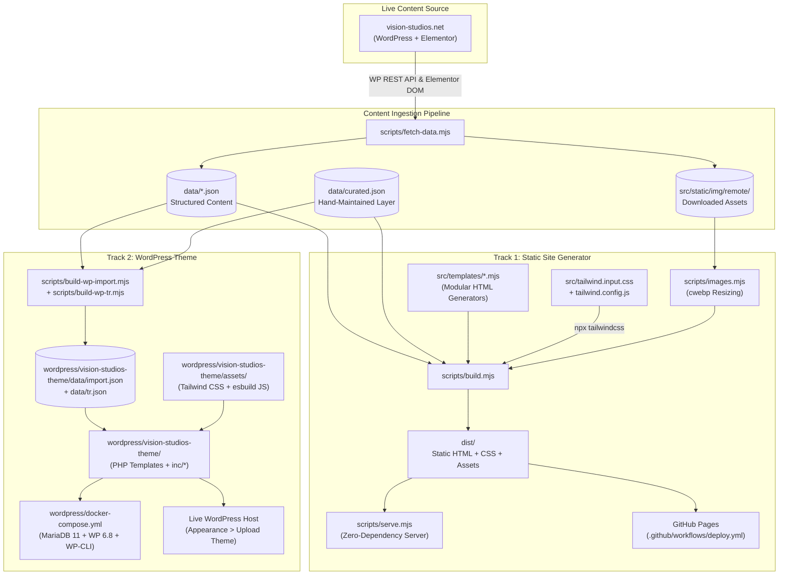
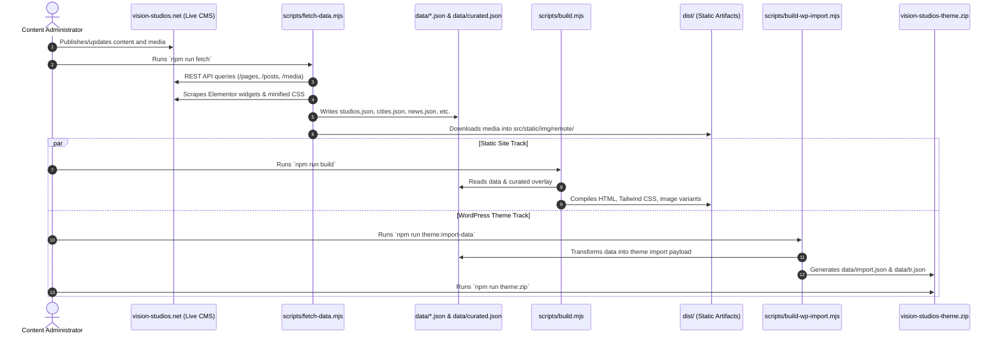

# System Architecture

This document describes the architectural design, system components, data pipelines, and runtime characteristics of the **Vision Studios** repository (`medhatse/Vision-Studio`).

---

## 1. Architectural Overview

The repository implements a **dual-track architecture** for Vision Studios, a multi-city broadcast and production studio provider with facilities in London, Dublin, Paris, and Istanbul:

1. **Track 1: High-Performance Static Site Generator (SSG)**
   A standalone, zero-npm-dependency Node.js static site generator that compiles structured JSON data and modular templates into pre-rendered static HTML, optimized CSS, and responsive WebP images in `dist/`.
2. **Track 2: Custom WordPress Theme & CMS Pipeline**
   A native, classic WordPress theme (`wordpress/vision-studios-theme/`) designed for deployment on WordPress 6.8+ (PHP 8.3). It includes custom post types, custom taxonomies, built-in meta boxes (eliminating the need for Advanced Custom Fields), an automated data importer, native multilingual handling for Turkish, and integrations with Rank Math SEO.

Both tracks share identical design tokens (Anton, Inter, Space Mono typography; dark editorial aesthetic with `#f2703a` orange accents), structured content data, and responsive layout standards.

---

## 2. High-Level Architecture Diagram

---

## 3. Track 1 — Static Site Generator (SSG)

### 3.1 Content Ingestion (`scripts/fetch-data.mjs`)

The fetch script inspects and extracts data from `https://vision-studios.net`:

- **REST Endpoints**: Queries `/wp-json/wp/v2/pages`, `/posts`, and `/media` via paginated requests (`per_page=100`).
- **DOM & Widget Extraction**: Parses rendered HTML blocks for Elementor widgets (description lists, icon boxes, call-to-action cards, counters, Google Maps query parameters).
- **CSS Scraping**: Extracts studio gallery slide background image URLs embedded inside page-specific minified CSS files (`wpo-minify`).
- **Asset Mirroring**: Normalizes image URLs, strips WordPress dimension suffixes (e.g., `-150x150`, `-1024x768`), and downloads original-resolution assets into `src/static/img/remote/` (~228 assets, ~25 MB).
- **Output Artifacts**: Writes JSON records into `data/studios.json`, `data/cities.json`, `data/about.json`, `data/contact.json`, `data/news.json`, `data/media-index.json`, and `data/site.json`.

> **Note**: `data/curated.json` is a manually maintained presentation layer containing curated hero copy, coordinates, service cards, and gallery selections. `scripts/fetch-data.mjs` never overwrites `curated.json`.

### 3.2 Page Rendering Engine (`scripts/build.mjs`)

The rendering engine generates pure, dependency-free static HTML:

- **Data Assembly**: Loads `site`, `studios`, `cities`, `home`, `about`, `contact`, `news`, `curated`, and `copy` JSON files.
- **Template System**:
  - `src/templates/helpers.mjs`: Core HTML shell, `<head>` metadata, Open Graph / Twitter Card tags, schema.org JSON-LD generators, header navigation, footer, and breadcrumbs.
  - `src/templates/home.mjs`: Homepage with hero section, stats counters, 4 city cards, services, gallery previews, client logo wall, latest news, and booking CTA.
  - `src/templates/city.mjs`: Dedicated landing pages for London, Dublin, Paris, and Istanbul with localized studio listings, services, interactive map facade, and regional contact details.
  - `src/templates/studio.mjs`: Studio specification pages (14 total) with hero slider, technical highlights, dimensions, floor plan modal, photo gallery, use-case matrix, and booking form.
  - `src/templates/pages.mjs`: Studio directory (`/studios/`), news index and article detail views (`/news/`, `/news/<slug>/`), About (`/about/`), Contact (`/contact/`), filterable Gallery (`/gallery/`), and `404.html`.
- **CSS Compilation**: Executes `tailwindcss@3.4.17` via `npx -y` against `tailwind.config.js` and `src/tailwind.input.css` to emit minified `dist/static/app.css`.
- **URL Rebasing**: Transforms all root-relative paths when `BASE_PATH` is specified (critical for GitHub Pages hosting under sub-paths like `/Vision-Studio`).
- **Legacy URL Redirects**: Generates HTML redirect stubs (`<meta http-equiv="refresh">`) and a platform-agnostic `_redirects` file for Netlify, Cloudflare, and Apache environments.
- **SEO & Discovery**: Generates `dist/sitemap.xml` and `dist/robots.txt`. Writes `dist/CNAME` if `CNAME_DOMAIN` is supplied.

### 3.3 Responsive Image Pipeline (`scripts/images.mjs`)

- Inspects image headers without third-party libraries to extract native dimensions for WebP (`RIFF`), PNG, and JPEG (`SOF0`/`SOF2`).
- Computes `srcset` descriptors for target widths: `640w`, `1024w`, and `1600w`.
- When `cwebp` is installed in the system PATH, generates compressed WebP variants (`-q 78`) during the build process.
- If `cwebp` is not present, falls back gracefully to serving original images without breaking page generation.

### 3.4 Client-Side Interactivity (`src/static/app.js`)

A lightweight, zero-dependency vanilla JavaScript module (~13 KB unminified) that provides:
- Sticky header state tracking on scroll.
- Mobile navigation menu toggle and focus management.
- IntersectionObserver-powered fade-up reveal animations and counter increments.
- Studio hero image carousel with auto-rotation, pause on hover, and keyboard controls.
- Fullscreen modal lightbox for floor plans and studio image galleries.
- Click-to-load Google Maps facade (saving ~1 MB of third-party JS execution on initial page load).
- Filterable gallery tabs with instant client-side DOM filtering.
- Client-side form handling with `mailto:` fallback targeting `booking@vision-studios.net`.

---

## 4. Track 2 — WordPress Theme Architecture

### 4.1 Theme Structure (`wordpress/vision-studios-theme/`)

The WordPress theme is structured as a classic theme compatible with WordPress 6.8+ and PHP 8.3:

| Path / File | Purpose |
|---|---|
| `style.css` | Theme metadata (Name: Vision Studios, Version: 1.2.0, Author: Vision Studios). |
| `functions.php` | Bootstrap loader, image sizes (`vs-card`, `vs-wide`, `vs-thumb`), asset enqueuing, font preload. |
| `inc/post-types.php` | Registers `studio` custom post type and `city` custom taxonomy. |
| `inc/meta-boxes.php` | Native custom fields for studio specs, highlights, gallery images, use cases, FAQs, and contact info. |
| `inc/customizer.php` | Theme customizer panel for global contacts, hero messaging, stats, counters, and CF7 form shortcodes. |
| `inc/importer.php` | Ingestion script (`wp vs import` or admin UI) that loads `data/import.json` into WordPress database posts and terms. |
| `inc/seo.php` | Native JSON-LD structured data (`LocalBusiness`, `Organization`, `WebSite`, `BreadcrumbList`), Open Graph, and meta tags. |
| `inc/rankmath.php` | Rank Math SEO integration; defers meta and sitemaps to Rank Math while injecting custom studio/city schema. |
| `inc/turkish.php` | Multilingual URL routing and content filtering for `/tr/` routes without external multilingual plugins. |
| `inc/redirects.php` | Canonical redirects from legacy Elementor URLs to new studio and city URL structures. |
| `inc/compat.php` | Strips unused WordPress header scripts/styles (emojis, RSD, wlwmanifest) and manages SVG upload capabilities. |
| `inc/icons.php` | Reusable inline SVG icons for camera equipment, audio, lighting, green screen, and studio features. |

### 4.2 Asset Compilation Chain

- **Tailwind CSS**: Compiled using `wordpress/tailwind.config.js` and `wordpress/tailwind.input.css` into `wordpress/vision-studios-theme/assets/app.css`.
- **JavaScript**: Minified using `esbuild` from `app.src.js` to `app.js`.
- **CSS Enhancements**: Minified using `esbuild` from `post-production.src.css` to `post-production.css`.
- **Theme Archive**: `npm run theme:zip` bundles the clean theme directory into `wordpress/vision-studios-theme.zip`, automatically excluding source files (`*.src.js`, `*.src.css`) and OS metadata (`.DS_Store`).

### 4.3 Turkish Multilingual Architecture (`inc/turkish.php`)

The theme incorporates a lightweight, plugin-free multilingual subsystem for Turkish (`/tr/`):
- Maps `/tr/city/istanbul/` and `/tr/studios/<slug>/` rewrite endpoints.
- Swaps page copy dynamically using `_vs_tr_*` post meta fields populated from `data/tr.json`.
- Injects `hreflang="tr"` and `hreflang="en"` link relations in HTML headers.
- Emits dedicated XML sitemap entries at `/sitemap-tr.xml`.

---

## 5. Data Flow & Content Synchronization

---

## 6. Security & Infrastructure Boundaries

1. **Static Build Sandbox**: The static site generation runs entirely locally or in GitHub Actions. It does not expose listening server ports in production.
2. **Read-Only Ingestion**: The content fetcher only consumes public REST endpoints and public web assets; no administrative credentials, API tokens, or database connections are required.
3. **Form Handling**: Contact and booking forms fall back to standard `mailto:` links, preventing form spam injection and eliminating the need for server-side form processing scripts.
4. **Local Docker Environment**: The development Docker environment isolates MariaDB and WordPress within internal Docker bridge networks, binding only port `8080` to loopback (`127.0.0.1`).
